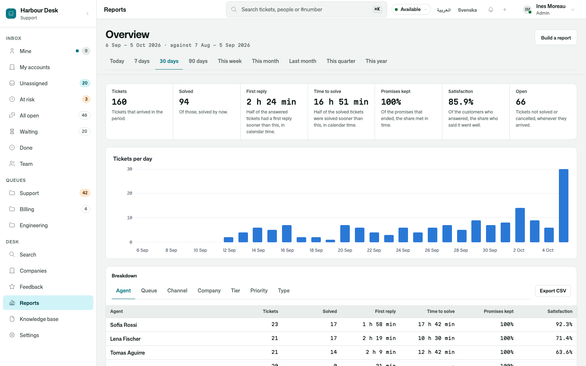
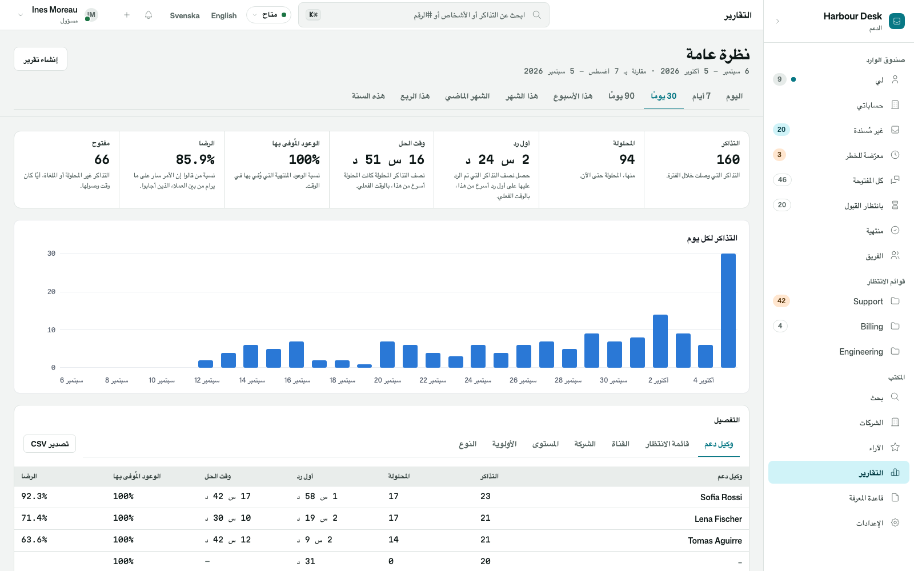

# Osysharp.WorkQueues.Reports

What your team's inbox did, as reports: how much came in, how much was done, how soon the first reply came and how long
finishing took (the median and the slowest tenth), what stands open now, and how many promises were kept. By agent,
queue, channel, organization, tier and priority, over any item kind your app works through `Osysharp.WorkQueues`.

It is the bridge between two kits, so neither depends on the other: an app that only works a queue does not get
reports, and `Osysharp.Reports` knows nothing about inboxes. Add both and say, in your own words, what you report on:

```osy
use Osysharp.WorkQueues@0;
use Osysharp.Reports@0;
// Osysharp.WorkQueues.Reports is not written: it arrives by itself, because the app uses what it completes (`osy lock` says so)
use Osysharp.Explore;

public InboxReportWords DeskWords() {
  return new InboxReportWords { Title = Translate("Tickets"), Noun = Translate("ticket"), Nouns = Translate("tickets"),
                                Done = Translate("Solved"), Finish = Translate("solve", key: "report-finish-verb"),
                                Organization = Translate("Company") };
}

public class TicketReports : IReportSource {
  public ReportSource Describe() { return InboxWorkSource("tickets", Explore.Root<Ticket>(), DeskWords()); }
}

public class PromiseReports : IReportSource {
  public ReportSource Describe() { return InboxPromiseSource("promises", DeskWords()); }
}

// The overview: tickets and the promises kept on them, side by side, by agent, queue, company…
ReportOverview("tickets", ["arrived", "done", "firstReply", "toDone", "promises:keptShare"], now: ["open"]);
```

Both sources take the same words, so one overview can put a figure from each in one breakdown: it joins them on the
grouping with the same name.

## What it counts, exactly

| | |
|---|---|
| **The work, by when it arrived** | `arrived`, `done` (done or closed, not cancelled), `doneShare`. "Of what arrived in March, how much is done": a figure never changes what it divides by under the reader |
| **First reply and time to done** | `firstReply`, `firstReplySlowest`, `toDone`, `toDoneSlowest`: the median and the 90th percentile of the calendar time from arrival, the time the requester actually waited |
| **Open now** | `open`: not done, closed or cancelled, whenever it arrived. Show it as an overview's `now`, where the period does not apply |
| **Promises, by when they started** | `ended`, `kept`, `keptShare`, `missed`: a promise counts once it has ended, met in time or late. One still running is neither kept nor missed yet, and a cancelled one measured nothing |
| **In business hours** | `firstReplyHours`, `toDoneHours`: the same medians as the promise clocks counted them, in the item's own business hours |
| **Groupings** | agent, queue, channel, organization, tier and priority, under your words, on both sources; and the promise itself |
| **As the reader may read** | an item in a restricted queue counts for nobody outside it, and neither do its promises |

| The helpdesk template's overview | …in Arabic |
|---|---|
|  |  |

## Its tests

The kit's test app is a building's maintenance desk: tenants report a leak or a dead light, technicians take the job,
and every promise is counted in office hours. A week of jobs is played through the inbox's real runs (round robin,
first replies, fixes, a promise answered late, one still owed) and every figure is checked against an answer worked out
by hand. A job in a restricted queue is shown to count for nobody outside it, its promises included.
